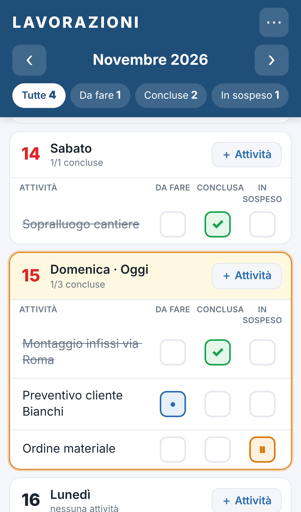

# LAVORAZIONI

App per Android e iPhone per scrivere le **attività del mese, giorno per giorno**.
Accanto a ogni attività ci sono tre caselle: **Da fare**, **Conclusa**, **In sospeso**.

## Come si usa
- **‹ ›** in alto (o scorri col dito a destra/sinistra) per cambiare mese; tocca il nome del mese per tornare a oggi.
- **＋ Attività** sul giorno, scrivi e premi Invio (puoi aggiungerne più di una di fila).
- Tocca una delle tre caselle per impostare lo stato. Le attività concluse vengono barrate.
- Tocca il testo per modificarlo. **Tieni premuto** su un'attività per spostarla al giorno dopo/prima, duplicarla o eliminarla.
- I pulsanti in alto (Tutte / Da fare / Concluse / In sospeso) mostrano i totali del mese e filtrano l'elenco.
- Menu **⋯**: mostra solo i giorni con attività, porta le non concluse al mese dopo, condividi il riepilogo (WhatsApp, email…), salva/ripristina backup, svuota il mese.

I dati restano **sul telefono** (nessun account, funziona anche offline). Usa *Salva backup* ogni tanto.

## Installarla sul telefono
L'app è una web‑app installabile: va pubblicata una volta su un indirizzo `https://`, per esempio con GitHub Pages
(repository → **Settings → Pages** → Branch `main`, cartella `/root` → Save). L'indirizzo sarà
`https://<utente>.github.io/<repository>/lavorazioni/`.

- **iPhone (Safari):** apri l'indirizzo → pulsante **Condividi** → **Aggiungi alla schermata Home**.
- **Android (Chrome):** apri l'indirizzo → menu **⋮** → **Installa app** (o *Aggiungi a schermata Home*).

Comparirà l'icona **LAVORAZIONI** e si aprirà a schermo intero come un'app normale.
